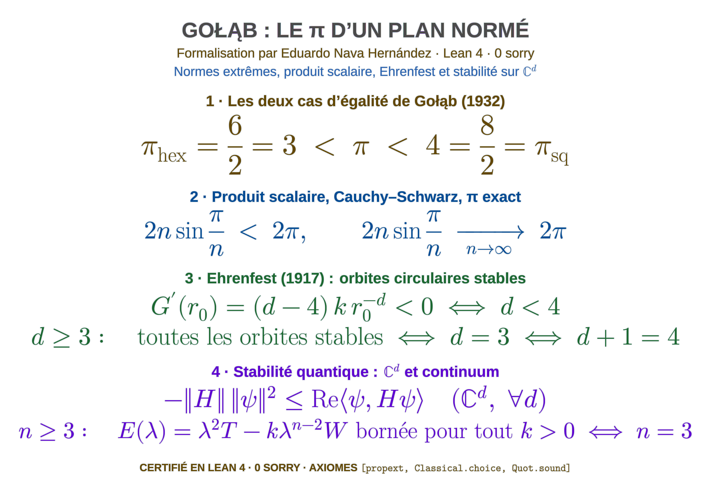
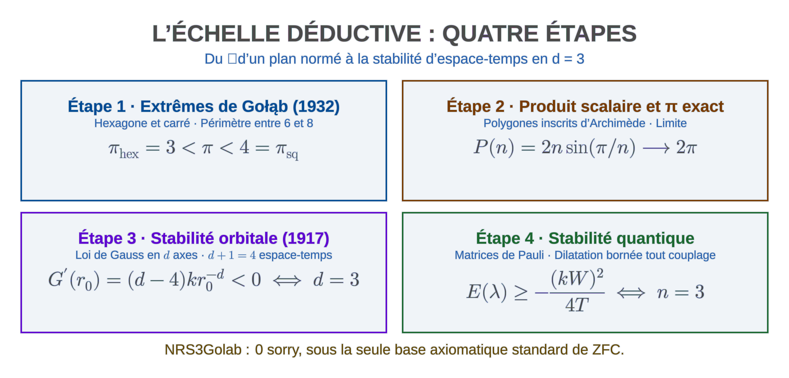
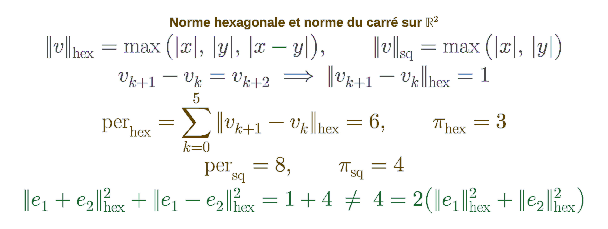
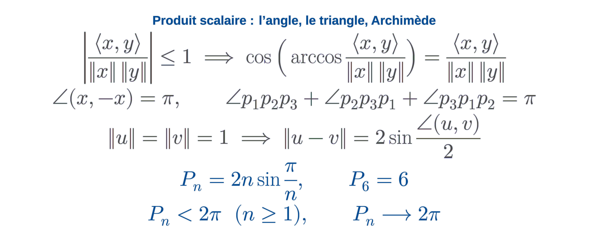
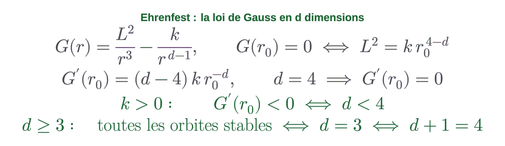
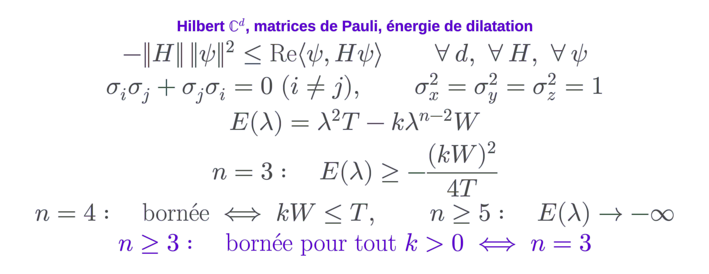

<div align="center">

# RS^N³ · Gołąb
### Le π d'un plan normé : 3 pour l'hexagone, 4 pour le carré, π exact pour le produit scalaire ; la stabilité choisit d = 3

**Eduardo Nava Hernández**  
*Vérification formelle certifiée en Lean 4 · 0 sorry · Mathlib*

[](https://leanprover.github.io/)
[](https://github.com/leanprover-community/mathlib4)
[](NRS3Golab/Hexagon.lean)
[](https://github.com/leanprover-community/physlib/pulls?q=is%3Apr+is%3Amerged+author%3Anaype888-cloud)

</div>

---

> ### 🏛️ Le π d'un plan dépend de sa norme
>
> <div align="center">
> <picture><source media="(prefers-color-scheme: dark)" srcset="assets/oscuro/plaque_golab_protagoniste.png"></picture>
> </div>
>
> **1 · Les deux cas d'égalité de Gołąb (1932).** Mesuré avec sa propre norme, le cercle unité d'un plan normé a un périmètre entre 6 et 8. La norme hexagonale atteint 6, soit π_hex = 3 ; la norme du carré atteint 8, soit π_sq = 4.
>
> **2 · Le produit scalaire fixe π.** Cauchy–Schwarz rend l'angle bien défini ; l'angle plat vaut π, les angles d'un triangle somment à π, et les polygones inscrits d'Archimède ont un périmètre 2n sin(π/n) → 2π.
>
> **3 · Ehrenfest (1917).** En d axes spatiaux, une orbite circulaire est stable si et seulement si d < 4 ; parmi d ≥ 3, seul d = 3, soit un espace-temps de dimension d + 1 = 4.
>
> **4 · La contrepartie quantique.** Sur ℂ^d, tout opérateur est borné inférieurement, quel que soit d ; dans le continu, l'énergie de dilatation reste bornée pour tout couplage si et seulement si n = 3.

---

## ⚡ Résumé formel

* La norme hexagonale `max(|x|, |y|, |x − y|)` est une norme dont le cercle unité est exactement un hexagone de périmètre 6 ; la norme du carré donne un périmètre 8. Les deux bornes de Gołąb sont atteintes : [`NRS3Golab/Hexagon.lean`](NRS3Golab/Hexagon.lean) (`hexPerimeter_eq_six`, `hexPi_eq_three`, `sqPerimeter_eq_eight`, `sqPi_eq_four`, `golab_extremes`).
* La norme hexagonale viole l'identité du parallélogramme et ne provient d'aucun produit scalaire : [`NRS3Golab/Hexagon.lean`](NRS3Golab/Hexagon.lean) (`hexNorm_not_parallelogram`).
* Dans un espace préhilbertien réel, l'angle, le triangle et les polygones d'Archimède donnent π exactement : [`NRS3Golab/InnerProductPi.lean`](NRS3Golab/InnerProductPi.lean) (`cos_angle_of_cauchySchwarz`, `angle_self_neg`, `triangle_angle_sum`, `tendsto_archimedesPerimeter`).
* La stabilité des orbites circulaires sous la loi de Gauss en d dimensions est équivalente à d < 4 : [`NRS3Golab/OrbitStability.lean`](NRS3Golab/OrbitStability.lean) (`deriv_radialForce_circular`, `stable_iff`, `stable_iff_spacetime_four`).
* Sur ℂ^d l'énergie est bornée inférieurement pour tout d ; le long de l'orbite de dilatation, la borne pour tout couplage ne vaut qu'en n = 3 : [`NRS3Golab/QuantumStability.lean`](NRS3Golab/QuantumStability.lean) (`re_inner_ge_of_Cd`, `bddBelow_all_couplings_iff`).

---

## 📐 Démonstration constructive en quatre étapes

<div align="center">
<picture><source media="(prefers-color-scheme: dark)" srcset="assets/oscuro/plaque_golab_etapes.png"></picture>
</div>

### Étape 1 : Les deux normes extrêmes de Gołąb

> **Proposition 1.1 (Hexagone, π = 3).** La fonction `hexNorm v = max(|v₁|, |v₂|, |v₁ − v₂|)` est une norme sur ℝ². Son cercle unité est exactement l'hexagone de sommets (1,0), (1,1), (0,1), (−1,0), (−1,−1), (0,−1) ; chaque côté mesure 1, le périmètre vaut 6 et π_hex = 3.
>
> **Proposition 1.2 (Carré, π = 4).** Pour `sqNorm v = max(|v₁|, |v₂|)`, le périmètre vaut 8 et π_sq = 4. Ainsi π_hex = 3 < π < 4 = π_sq.

<div align="center"><picture><source media="(prefers-color-scheme: dark)" srcset="assets/oscuro/plaque_golab_etape1.png"></picture></div>

*Module formel (norme) :* [`NRS3Golab/Hexagon.lean`](NRS3Golab/Hexagon.lean) (`hexNorm_add_le`, `hexNorm_smul`, `hexNorm_eq_zero_iff`).  
*Module formel (cercle unité) :* [`NRS3Golab/Hexagon.lean`](NRS3Golab/Hexagon.lean) (`hexNorm_vertex`, `hexNorm_edge`, `exists_edge_of_hexNorm_eq_one`).  
*Module formel (périmètre et π) :* [`NRS3Golab/Hexagon.lean`](NRS3Golab/Hexagon.lean) (`hexVertex_edge_eq`, `hexNorm_edge_vector`, `segment_length`, `hexPerimeter_eq_six`, `hexPi_eq_three`, `hexNorm_sub_le_two`, `hexNorm_diameter`, `sqPerimeter_eq_eight`, `sqPi_eq_four`, `golab_extremes`).

Chaque vecteur d'arête est encore un sommet, v(k+1) − v(k) = v(k+2) (`hexVertex_edge_eq`), donc chaque côté a longueur 1. La longueur d'un segment est la norme de son vecteur le long de toute subdivision (`segment_length`, l'homogénéité télescope). Le diamètre vaut 2 (`hexNorm_sub_le_two`, `hexNorm_diameter`), d'où π_hex = 6 / 2 = 3. Avec e₁ = (1,0), e₂ = (0,1) : 1² + 2² = 5 ≠ 4, l'identité du parallélogramme échoue (`hexNorm_not_parallelogram`).

---

### Étape 2 : Produit scalaire, Cauchy–Schwarz et π exact

> **Proposition 2.1 (L'angle est un angle).** Dans un espace préhilbertien réel, |⟨x, y⟩ / (‖x‖ ‖y‖)| ≤ 1, donc cos(arccos(⟨x, y⟩ / (‖x‖ ‖y‖))) = ⟨x, y⟩ / (‖x‖ ‖y‖).
>
> **Proposition 2.2 (Archimède).** Une corde entre vecteurs unitaires d'angle θ mesure 2 sin(θ/2). Le n-gone régulier inscrit a pour périmètre P(n) = 2n sin(π/n) ; P(6) = 6, P(n) < 2π pour n ≥ 1, et P(n) → 2π.

<div align="center"><picture><source media="(prefers-color-scheme: dark)" srcset="assets/oscuro/plaque_golab_etape2.png"></picture></div>

*Module formel (angle) :* [`NRS3Golab/InnerProductPi.lean`](NRS3Golab/InnerProductPi.lean) (`cauchySchwarz_ratio`, `cos_angle_of_cauchySchwarz`, `angle_self_neg`, `triangle_angle_sum`, `parallelogram`).  
*Module formel (Archimède) :* [`NRS3Golab/InnerProductPi.lean`](NRS3Golab/InnerProductPi.lean) (`norm_sub_unit`, `side_regular_polygon`, `archimedesPerimeter_six`, `archimedesPerimeter_lt`, `tendsto_archimedesPerimeter`, `hexagon_lt_circle`).

L'hexagone inscrit a encore périmètre 6 (`archimedesPerimeter_six`), comme à l'étape 1 ; mais pour une norme issue d'un produit scalaire le cercle est la limite des polygones inscrits, 2π > 6 (`hexagon_lt_circle`). Seules ces normes satisfont l'identité du parallélogramme (`parallelogram`).

---

### Étape 3 : Ehrenfest, des orbites stables exactement pour d < 4

> **Proposition 3.1 (Taux de rappel).** En d axes spatiaux, la force radiale effective d'une masse unité de moment cinétique L est G(r) = L²/r³ − k/r^(d−1). Une orbite circulaire de rayon r₀ vérifie G(r₀) = 0 ⟺ L² = k r₀^(4−d), et alors G′(r₀) = (d − 4) k r₀^(−d).
>
> **Proposition 3.2 (Ehrenfest, 1917).** Pour k > 0, l'orbite est stable, G′(r₀) < 0, si et seulement si d < 4. Parmi d ≥ 3, toutes les orbites circulaires sont stables si et seulement si d = 3, soit d + 1 = 4.

<div align="center"><picture><source media="(prefers-color-scheme: dark)" srcset="assets/oscuro/plaque_golab_etape3.png"></picture></div>

*Module formel (équilibre) :* [`NRS3Golab/OrbitStability.lean`](NRS3Golab/OrbitStability.lean) (`radialForce`, `radialForce_eq_zero_iff`, `exists_circular`).  
*Module formel (stabilité) :* [`NRS3Golab/OrbitStability.lean`](NRS3Golab/OrbitStability.lean) (`deriv_radialForce_circular`, `deriv_radialForce_circular_four`, `stable_iff`, `stable_iff_eq_three`, `stable_iff_spacetime_four`).

Pour tout r₀ > 0 il existe un L qui rend l'orbite circulaire (`exists_circular`). En d = 4 l'orbite est neutre (`deriv_radialForce_circular_four`) ; en d ≥ 5 elle est instable.

---

### Étape 4 : Stabilité quantique sur ℂ^d et dans le continu

> **Proposition 4.1 (ℂ^d, tout d).** Pour tout d, tout opérateur H sur ℂ^d et tout ψ : −‖H‖ ‖ψ‖² ≤ Re⟨ψ, Hψ⟩. En dimension finie l'énergie est toujours bornée inférieurement.
>
> **Proposition 4.2 (Trois axes depuis ℂ²).** Les trois matrices de Pauli anticommutent deux à deux et sont de carré 1.
>
> **Proposition 4.3 (Ehrenfest quantique).** Pour −Δ − k/r^(n−2) en n axes, la dilatation donne E(λ) = λ²T − kλ^(n−2)W. En n = 3, E(λ) ≥ −(kW)²/(4T) ; en n = 4, bornée ⟺ kW ≤ T ; en n ≥ 5, E(λ) → −∞. Parmi n ≥ 3, l'énergie est bornée pour tout couplage k > 0 si et seulement si n = 3.

<div align="center"><picture><source media="(prefers-color-scheme: dark)" srcset="assets/oscuro/plaque_golab_etape4.png"></picture></div>

*Module formel (ℂ^d) :* [`NRS3Golab/QuantumStability.lean`](NRS3Golab/QuantumStability.lean) (`re_inner_ge_of_Cd`, `re_inner_ge_of_Cd_linear`).  
*Module formel (Pauli) :* [`NRS3Golab/QuantumStability.lean`](NRS3Golab/QuantumStability.lean) (`pauli_anticomm_xy`, `pauli_anticomm_yz`, `pauli_anticomm_zx`, `pauli_sq`).  
*Module formel (dilatation) :* [`NRS3Golab/QuantumStability.lean`](NRS3Golab/QuantumStability.lean) (`dilationEnergy`, `dilationEnergy_three_ge`, `bddBelow_four_iff`, `dilationEnergy_unbounded`, `bddBelow_all_couplings_iff`).  
*Physlib :* PR #1762, PR #1768.

La borne sur ℂ^d est Cauchy–Schwarz plus la norme d'opérateur. La proposition 4.3 est la contrepartie quantique de `stable_iff_eq_three` (étape 3).

---

## 🔬 Contributions Physlib fusionnées liées

| PR Physlib | Titre | Lien avec ce dépôt | Statut |
|:---:|:---|:---|:---:|
| [**#1762**](https://github.com/leanprover-community/physlib/pull/1762) | the Pauli matrices are a maximal anticommuting family | Maximalité des trois axes de Pauli (aucun quatrième dans su(2)), étape 4 | **MERGED** |
| [**#1768**](https://github.com/leanprover-community/physlib/pull/1768) | the gamma matrices need four dimensions | Le d = 4 strict des matrices de Dirac, étape 4 | **MERGED** |

---

## 📚 Catalogue des modules Lean

| Module | Théorème principal | Signification | `sorry` |
|:---|:---|:---|:---:|
| [`NRS3Golab/Hexagon.lean`](NRS3Golab/Hexagon.lean) | `golab_extremes` | π_hex = 3 < π < 4 = π_sq : les deux cas d'égalité de Gołąb | 0 |
| [`NRS3Golab/InnerProductPi.lean`](NRS3Golab/InnerProductPi.lean) | `tendsto_archimedesPerimeter` | Produit scalaire → Cauchy–Schwarz → π exact (Archimède) | 0 |
| [`NRS3Golab/OrbitStability.lean`](NRS3Golab/OrbitStability.lean) | `stable_iff_spacetime_four` | Ehrenfest : orbites stables ⟺ d < 4 ; parmi d ≥ 3, d + 1 = 4 | 0 |
| [`NRS3Golab/QuantumStability.lean`](NRS3Golab/QuantumStability.lean) | `bddBelow_all_couplings_iff` | ℂ^d borné pour tout d ; dilatation bornée pour tout couplage ⟺ n = 3 | 0 |

### Portée

* Gołąb général (6 ≤ périmètre ≤ 8 pour toute norme) n'est pas démontré ici ; ses deux cas d'égalité le sont.
* La circonférence euclidienne est prise comme limite des polygones inscrits (Archimède) ; la longueur d'arc de t ↦ (cos t, sin t) n'est pas calculée.
* `OrbitStability` est la mécanique newtonienne avec la loi de Gauss en d dimensions ; la relativité générale et la version quantique de l'hydrogène (Tangherlini, 1963) ne sont pas traitées.
* Dans `QuantumStability`, partie 3, la borne pour n = 3 porte sur l'orbite de dilatation d'un état avec T, W > 0 ; la borne sur tous les états demande l'inégalité de Hardy, non démontrée ici.

---

## 🏛️ Le Mosaïque

| Dépôt | Objet |
|:---|:---|
| [**nava-robertson-schrodinger**](https://github.com/naype888-cloud/nava-robertson-schrodinger) | Le canon : l'incertitude élémentaire dimensionnelle sur le cube ouvert |
| [`lean4-commits`](https://github.com/naype888-cloud/lean4-commits) | Les PRs Lean 4 fusionnées et ouvertes dans Physlib |
| [`Proper-Time-General-Relativity`](https://github.com/naype888-cloud/Proper-Time-General-Relativity) | Le temps compte les pas à quatre sites |
| [`nrs3-tightbinding`](https://github.com/naype888-cloud/nrs3-tightbinding) | La chaîne de Physlib et la table périodique |
| [`nrs3-cristales`](https://github.com/naype888-cloud/nrs3-cristales) | Cristaux : forme par la symétrie, taille par le spectre |
| [`nrs3-mandelstam-tamm-cramer-rao`](https://github.com/naype888-cloud/nrs3-mandelstam-tamm-cramer-rao) | Vitesse d'évolution et borne d'estimation de phase |
| [`nrs3-completude`](https://github.com/naype888-cloud/nrs3-completude) | Complétude constructive |
| [`bacqm-systems`](https://github.com/naype888-cloud/bacqm-systems) | Dynamique de mémoire invariante d'échelle |

---

## ⏱️ Chronologie

| Année | Résultat | Étape |
|:---:|:---|:---:|
| **IIIᵉ s. av. J.-C.** | Archimède : polygones inscrits au cercle | 2 |
| **1917** | Ehrenfest : la stabilité des orbites distingue trois dimensions d'espace | 3 |
| **1927** | Pauli : matrices de spin | 4 |
| **1932** | Gołąb : le cercle unité d'un plan normé a un périmètre entre 6 et 8 | 1 |
| **1963** | Tangherlini : champ de Schwarzschild en n dimensions (référence, non traité) | — |

---

## 🛠️ Reproduction et vérification formelle en Lean 4

```bash
lake exe cache get
lake build
```

### Base axiomatique standard

Les théorèmes principaux (`golab_extremes`, `hexNorm_not_parallelogram`, `exists_edge_of_hexNorm_eq_one`, `tendsto_archimedesPerimeter`, `archimedesPerimeter_lt`, `triangle_angle_sum`, `stable_iff`, `stable_iff_spacetime_four`, `re_inner_ge_of_Cd`, `pauli_sq`, `bddBelow_all_couplings_iff`) dépendent uniquement de :

```text
[propext, Classical.choice, Quot.sound]
```

* **0 `sorry`**, aucun axiome additionnel.

### Références

* S. Gołąb, *Quelques problèmes métriques de la géometrie de Minkowski*, Trav. Acad. Mines Cracovie 6 (1932).
* J. J. Schäffer, *Geometry of Spheres in Normed Spaces*, Marcel Dekker, 1976.
* P. Ehrenfest, *In what way does it become manifest in the fundamental laws of physics that space has three dimensions?*, Proc. Amsterdam Acad. 20 (1917) 200–209.
* F. R. Tangherlini, *Schwarzschild field in n dimensions and the dimensionality of space problem*, Nuovo Cimento 27 (1963) 636–651.
* L. D. Landau, E. M. Lifshitz, *Quantum Mechanics*, §35 (chute vers le centre).

---

## 📜 Licence

[NRS Noncommercial License 1.0.0](LICENSE).

---

<div align="center">

### 📐 *« Le cercle d'un plan normé mesure entre 6 et 8 ; le produit scalaire le fixe à 2π, et la stabilité fixe d = 3. »*

**Eduardo Nava Hernández** · [naype888-cloud](https://github.com/naype888-cloud)

</div>
